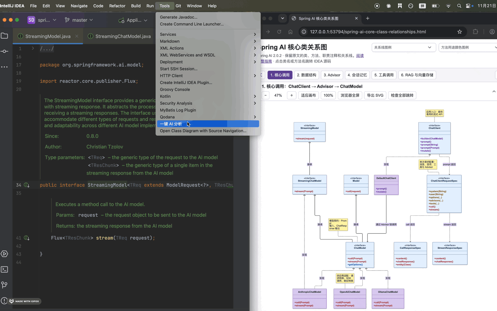

# iibobo skills

可复用的 Agent 技能集合，把工程任务中的操作步骤、检查标准和运行资源放在一起。目前包含三个技能：绘制类与接口关系图、梳理调用顺序的时序图，以及表达处理步骤与判断分支的流程图，均使用 Mermaid 并可生成可迁移的离线 HTML。类图技能默认为类和方法创建源码跳转入口。

配合 IntelliJ IDEA 插件 **Diagram Source Navigator**，可点击类图中的类名或方法，直接跳转到 IDEA 中对应的 Java 类或方法声明。安装插件后，通过 IDEA 的 **Tools → Open Class Diagram with Source Navigation…** 打开生成的 HTML；目标项目需已导入对应源码或依赖。具体见[使用说明](docs/engineering/render-class-diagrams.md)。

每个技能都可以独立安装和使用，也可以通过 `iibobo-skills` 插件一起分发。

仓库内的 `iibobo` 是自建插件市场的名称。将插件文件推送到可访问的 GitHub 仓库后，其他用户可添加该仓库作为市场来源并安装插件；上架 ChatGPT / Codex 公共插件目录还需按[官方流程](https://developers.openai.com/plugins/deploy/submission)单独提交审核。

**在 Codex 中调用绘图技能**


插件仓库：[iibobo/skills](https://github.com/iibobo/skills)

## 源码跳转演示

**IDEA 插件：Diagram Source Navigator**


**操作演示：打开类图，点击类名或方法跳转到 IDEA 源码。**



## 安装与开始使用

1. 按[安装文档](docs/installation.md)选择 Codex 或 Claude Code 插件安装；需要自行修改技能文件时，可选择独立技能安装。同一 Agent 选择一种方式，避免重复发现。
2. 安装后开启新会话，按安装文档中对应的名称显式调用技能；支持自动调用的 Agent 也可根据任务描述选用该技能。插件安装与独立安装的调用名称不同。
3. 例如：“根据当前模块源码绘制类与接口关系图，标注继承和实现关系，输出可离线打开的 HTML。”

安装命令、调用名称、项目开发方式与更新说明统一维护在[安装文档](docs/installation.md)。

生成 HTML 需要 Python 3.9+，查看页面和导出 SVG 需要现代浏览器。技能自带离线渲染资源；绘制真实代码的关系图时，还需提供可读取的源码或对应版本的依赖文件。

## 这些技能解决什么问题

### 读源码时难以看清类型关系

类图工作流要求先核对真实声明，再整理类型职责、核心方法、继承与实现关系，并默认生成源码导航所需的符号映射。配合 Diagram Source Navigator，可从图中跳转到 Java 类和方法，适合梳理模块结构、阅读依赖库和讲解设计。具体见[使用说明](docs/engineering/render-class-diagrams.md)。

### 调用链的先后、分支和异步行为难以追踪

时序图工作流根据源码或协议梳理参与者、请求、返回与事件投递，通过条件分支、循环及并行分组说明运行过程。适合解释请求链路、业务流程和消息消费，具体见[时序图使用说明](docs/engineering/render-sequence-diagrams.md)。

### 业务规则和控制逻辑难以逐条核对

流程图工作流梳理入口、处理步骤、判断、循环出口和异常结果，用明确的条件标签说明不同路径。适合业务流程、算法和控制逻辑，具体见[流程图使用说明](docs/engineering/render-flowcharts.md)。

### 图能生成，却难以搬移和复用

类图技能自带渲染模板和运行资源，统一配色、方法分类和关系标注。生成的 HTML 必须与相邻的同名 `.assets/` 目录一起搬移，才能保留离线查看所需的资源；在页面中可导出当前类图的 SVG。具体要求与成功标准见[使用说明](docs/engineering/render-class-diagrams.md)。

## 技能参考

技能按领域组织，再按调用方式分组。`User-invoked` 仅允许用户显式调用；`Model-invoked` 允许 Agent 在任务匹配时自动使用，也支持用户显式调用。实际发现与调用行为取决于宿主支持和配置，已测范围见[验证记录](docs/verification.md)。目前三个技能均属于工程领域的 `Model-invoked` 技能。

### Engineering · 工程

用于源码理解、设计表达和工程交付。完整分类索引见[工程技能](skills/engineering/README.md)。

#### Model-invoked

- [render-class-diagrams](skills/engineering/render-class-diagrams/SKILL.md)：绘制类与接口关系图，生成离线 HTML，支持 SVG 导出，默认创建类与方法的源码跳转入口；[使用说明](docs/engineering/render-class-diagrams.md)。

- [render-sequence-diagrams](skills/engineering/render-sequence-diagrams/SKILL.md)：绘制调用顺序、分支、循环与并行交互，生成离线 HTML 并支持 SVG 导出；[使用说明](docs/engineering/render-sequence-diagrams.md)。

- [render-flowcharts](skills/engineering/render-flowcharts/SKILL.md)：绘制处理步骤、判断分支、循环与子流程，生成离线 HTML 并支持 SVG 导出；[使用说明](docs/engineering/render-flowcharts.md)。

## 仓库维护

目录与发布边界：

```text
skills/engineering/              正式技能及其完整运行资源
.agents/skills/                  Codex 项目开发链接
.claude-plugin/                  插件与单插件市场清单
docs/engineering/                面向使用者的技能说明
scripts/                        结构校验和版本同步
.github/workflows/check.yml      持续集成检查
```

正式技能以 `skills/<分类>/<名称>/` 为唯一内容来源。项目发现链接与插件发布列表分别维护。只有出现对应技能时才新增 `productivity`、`in-progress`、`misc` 或 `deprecated` 分类。

以下命令用于维护仓库，需要 Node.js 22+、npm、Python 3.9+ 和 Claude Code CLI：

```bash
npm ci
npm run check
claude plugin validate . --strict
claude plugin validate .claude-plugin/plugin.json --strict
```

新增正式技能时，更新插件清单、根目录和分类索引、`docs/<分类>/<名称>.md`，并添加 `.agents/skills/<名称>` 项目链接。具体约束见 [AGENTS.md](AGENTS.md)。

`package.json` 是版本来源。准备版本时运行 `npm version patch --no-git-tag-version`（按需换为 `minor` 或 `major`）；生命周期脚本先校验，再同步插件版本。检查版本文件、锁文件和变更后再提交；远程推送和发布另行执行。本项目通过技能目录和插件分发；`package.json` 中的 `private: true` 用于防止误发布到 npm。

平台结构校验与真实加载的验证范围见[验证记录](docs/verification.md)。

本仓库的组织方式参考 [mattpocock/skills 的 README](https://github.com/mattpocock/skills/blob/main/README.md)：先说明安装与使用场景，再按领域和调用方式索引技能。技能编写与晋升规则见[编写约定](docs/authoring.md)。
