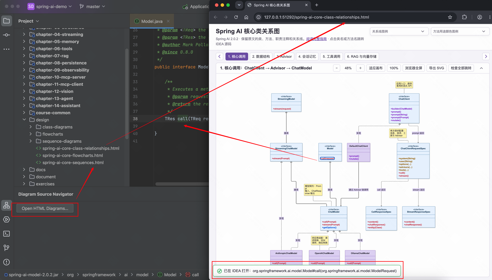
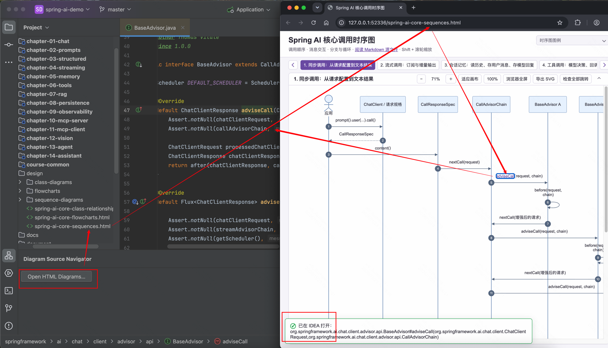
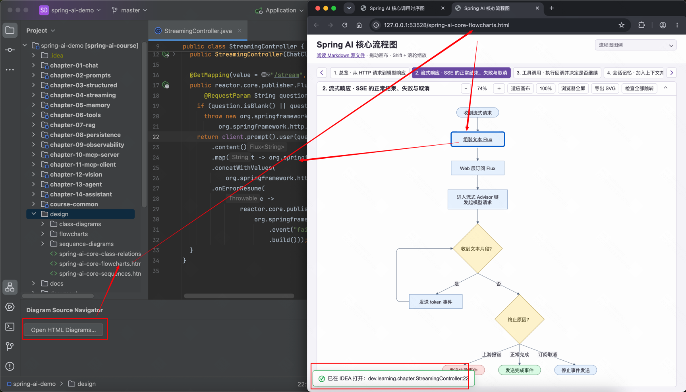

# iibobo skills

为 Codex 和 Claude Code 提供三种 Mermaid 图表技能。每个技能可独立安装，也可随 `iibobo-skills` 插件安装。支持离线 HTML、SVG 导出，以及在 IntelliJ IDEA 中通过 Diagram Source Navigator 跳转到已索引的 Java 源码。

## 开始使用

按[安装文档](docs/installation.md)选择宿主和安装方式。开启新会话后，描述图种、源码范围和所需格式。例如「根据当前订单代码画流程图，标出拒绝、重试与结束路径，输出离线 HTML」。

生成 HTML 需要 Python 3.9+。只需 Mermaid 或 Markdown 时，在任务中指定交付格式。分享离线页面时，将顶层 HTML 和相邻模块目录一起搬移。


## 工程技能

### Model-invoked

三个技能均支持自动发现与显式调用。按任务选择所需图种。

| 技能 | 适用问题 | 使用说明 |
| --- | --- | --- |
| [render-class-diagrams](skills/engineering/render-class-diagrams/SKILL.md) | 类型职责、继承、接口实现与核心方法 | [类图](docs/engineering/render-class-diagrams.md) |
| [render-sequence-diagrams](skills/engineering/render-sequence-diagrams/SKILL.md) | 跨参与者的调用顺序、返回与并发 | [时序图](docs/engineering/render-sequence-diagrams.md) |
| [render-flowcharts](skills/engineering/render-flowcharts/SKILL.md) | 步骤、条件、异常、循环与子流程 | [流程图](docs/engineering/render-flowcharts.md) |

## 源码跳转演示

<details>
<summary>查看类图、时序图和流程图实录</summary>

**IDEA 插件：Diagram Source Navigator**


**类图源码跳转**



**时序图源码跳转**



**流程图源码跳转**



**操作演示：打开类图，点击类名或方法跳转到 IDEA 源码。**


</details>

## 输出与隐私

日志、截图、图表、审计文件和回复仅保留与任务相关的非敏感信息。检查配置或源码前先过滤凭据。

## 仓库维护

正式技能与运行资源位于 `skills/engineering/`，贡献和分发约定见[技能编写](docs/authoring.md)。

```bash
npm ci
npm run check
claude plugin validate . --strict
claude plugin validate .claude-plugin/plugin.json --strict
```

`package.json` 是版本来源。使用 `npm version patch --no-git-tag-version` 更新补丁版本并同步插件清单。需要时改用 `minor` 或 `major`。打包步骤与平台实测见[分发约定](docs/authoring.md#构建发布包)和[验证记录](docs/verification.md)。
