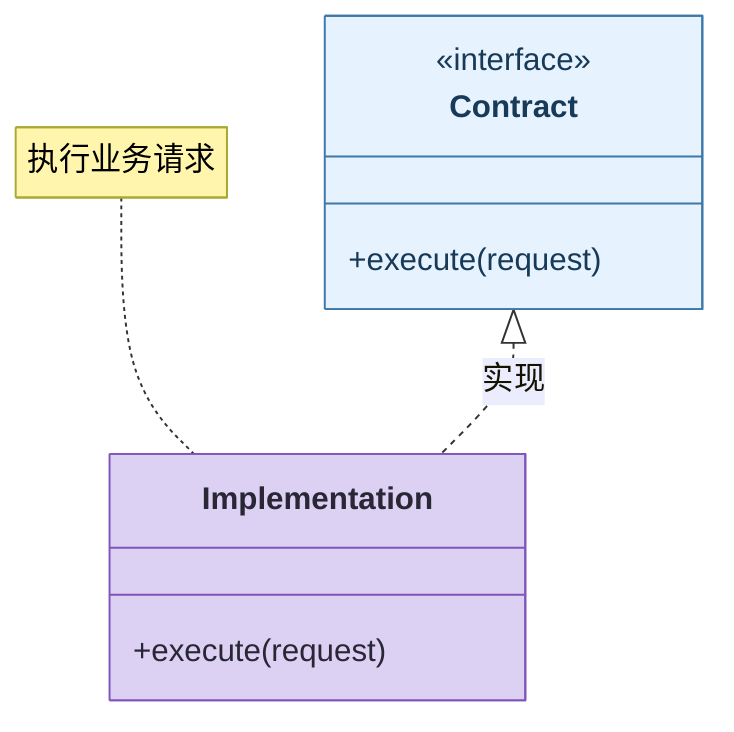

# 类图绘制规范

本规范定义本技能的类图默认样式与交互。用户当次要求优先。适用于任意项目；框架版本、类名、分图数量与核对结论均来自当前输入。

## 技能内资源

| 相对技能根目录的路径 | 用途 |
|---|---|
| `assets/viewer.html` | 通用离线展示模板，包含方法分类、导航、缩放、展示模式切换和导出 |
| `assets/example.md` | 独立的双图示例，演示类型、关系和配色写法 |
| `assets/class-diagram-layout.js` | 同层顶部对齐及连线端点调整 |
| `assets/mermaid-12.3.0.min.js`、`assets/mermaid-LICENSE` | 固定版本的本地渲染库与许可证 |
| `scripts/render_diagrams.py` | Markdown → 顶层 HTML 及模块资源目录生成器，仅使用 Python 3.9+ 标准库 |

新主题复用技能内模板及资源；技能放在任何目录均可执行，不读取调用项目的模板、配置或依赖缓存。修改默认视觉和交互时维护技能内资源，已有生成页面需按要求重新生成或单独同步。

## 内容与关系真实性

- 先确定目标源码或依赖版本。优先检查本地源文件、同版本 sources JAR；必要时使用官方仓库对应标签，避免混用 `current` 文档与旧版本。
- 每个节点写清真实类型、主要职责和代表性方法；方法签名可以简化，但注明省略泛型、重载和继承方法的范围。
- 按实际模块或关注点拆图，数量随内容调整。应用入口、输入输出、扩展机制、存储与工具等可分开表达。
- 每条继承/实现线对应真实的直接声明。若画间接关系，明确标注“间接”，或展开中间父类型。有意省略的辅助接口在正文说明。
- 职责用 `note for`，方法颜色表示用途，不表示 Java 修饰符；继承成员不要冒充当前类型自己的声明。

| Mermaid 关系 | 标注 | 含义 |
|---|---|---|
| `Parent <\|-- Child : 继承` | 继承 | 类继承或接口继承，空心三角指向父类型 |
| `Contract <\|.. Implementation : 实现` | 实现 | 类实现接口，虚线空心三角指向接口 |
| `Caller ..> Target : 调用方法` | 具体动作 | 依赖、使用、调用或创建 |
| `Owner --> Target : 委托存取` | 具体动作 | 关联或委托；仅在确有持有关系时称“持有” |
| `Whole o-- Part : 包含结果` | 包含内容 | 聚合/包含，空心菱形在整体一端 |

**所有关系线都要有文字。** 通过构造器注入或方法调用协作的两个类型，不因此形成继承关系。

## 固定视觉样式

背景为白色；默认 `direction TB`。字体沿用 Arial、PingFang SC、Microsoft YaHei 的顺序，Mermaid 基准字号为 16px。保持类名和 `«interface»` / `«abstract»` 标记可见。

| 节点类型 | 底色 | 边线 | 文字 |
|---|---|---|---|
| 接口 | `#E7F2FF` | `#3D78A8` | `#173A58` |
| 具体类 | `#DCD0F3` | `#8055BA` | `#292735` |
| 抽象类 | `#FFF0DD` | `#B67526` | `#694011` |
| 职责注释 | `#FFF5AD` | `#B5A842` | `#333333` |

节点类型颜色写进 Mermaid 原生 `style`，保证 Markdown 和 HTML 的节点配色一致。例如：



关系线深色 `#333333`，宽度为初始默认值的两倍，即 **2px**；箭头、菱形和虚线间隔保留 Mermaid 默认值。随图形正常缩放，不使用此前尝试过的屏幕恒定粗线。

### 方法颜色

方法字重为 **600**。渲染前通过 `themeCSS` 设置字重，让 Mermaid 按实际字重计算尺寸；渲染后将颜色和字重写入 SVG 文本及 `tspan` 的内联样式，确保导出一致。

| 用途 | 颜色 | 参考方法 |
|---|---|---|
| 创建 / 构建 | 紫 `#7C1CC4` | `builder`、`mutate`、`prompt` |
| 配置 / 增强 | 琥珀 `#946000` | `user`、`options`、`before`、`after` |
| 执行 / 调用 | 红 `#C21E32` | `call`、`stream`、`executeToolCalls` |
| 读取 / 查询 | 蓝 `#0057D9` | `get*`、`has*`、`find*`、`similaritySearch` |
| 写入 / 清理 | 绿 `#08753B` | `add`、`saveAll`、`delete`、`clear` |

按实际语义扩展生成页面中的 `methodKinds`，不能仅凭名称把未知方法强行归类。例如 Spring AI 的 `content`、`chatResponse`、`entity` 是执行入口；其他库中的同名方法需重新判断。图例使用相同颜色的加粗文字和彩色下边线。

普通 Markdown 查看器不支持页面对 SVG 的方法着色和布局后处理；需要这些效果时打开 HTML 或导出 SVG。

## 布局约束

- 关系线主干优先水平或垂直，转弯使用不超过 6px 的小圆角过渡，避免生硬的 90° 折角；沿原路由调整，保留起终点、箭头、标签与虚实线。若路径无法安全转换，保留原线并检查，不为了规整连线强行穿过类框。
- 所有箭头的可见尖端必须贴住类框边缘；以移动后的类框重新计算端点，并将 SVG marker 的 refX/refY 对准可见尖端，避免沿用原始 margin 偏移。空心三角和空心菱形使用白色实底遮挡后方线段，保持空心外观，线段不能穿过箭头/菱形内部。窄小的近竖直通道合并为同一条直线，不保留细碎侧移或弯曲；必要转弯仍用小圆角。
- 同层类框顶部水平对齐，保留真实成员，不用虚构方法或空白成员撑高节点。
- 复用 `class-diagram-layout.js` 时，保持其适用条件：已渲染的 Mermaid 12.3.0、TB 布局、层级之间有间隔、连线首尾段竖直。它依据现有节点纵向区间识别层级，不替代语义层级设计。
- 对齐会移动节点和所属注释并调整端点；修改图后检查连接是否仍贴合边界、方向是否正确、有无新增重叠。其他布局或运行库版本要重新验证，不能直接假设兼容。
- 普通视图使用纵向弹性布局，使画布填满页头、导航和工具栏下方的剩余窗口高度，底部只留 8–12px；窗口变化或工具栏折叠时自动伸缩。“适应画布”同时计算可用宽高，完整展示整图，重置画布滚动；全屏预留左上导航和右下控件空间。

## 交互约定

1. **导航**：标签、上一张/下一张按钮和键盘 `←` / `→` 均循环切换。移动焦点使用 `preventScroll`，动态内容关闭滚动锚定，页面不能上下跳动。编辑控件内不拦截方向键。
2. **展示模式**：默认 → 浏览器全屏（铺满浏览器内容区域）→ 屏幕全屏（原生 Fullscreen API）→ 默认。按钮显示下一种模式；全屏右下仍有切换入口；`Esc` 直接回默认。原生全屏不可用时跳过该模式。
3. **全屏界面**：只保留画布、左上紧凑导航和右下缩放/模式条；退出后导航恢复原位，折叠状态保留。窄屏导航横向滚动并显示当前标签。
4. **缩放**：按钮缩放、100%、适应画布；普通和全屏下，在画布内按住 `Shift` 滚轮缩放，向上放大、向下缩小，范围 10%–300%。尽量保持鼠标锚点；无 Shift 的滚动和图外滚动不受影响。
5. **紧凑与独立折叠**：导航上下间距为 6–8px；普通视图的两组图例并排置于页面标题区域右上角，顶部对齐，默认收起，展开内容使用绝对定位浮层，不改变页头、导航和画布位置；点击整个图例标题框（标题、空白或箭头）切换展开/折叠；浮层内容点击不触发切换；一次打开一组，点击外部或 Esc 收起，不占用整行高度；工具栏上下内边距为 4px，标题 14px、工具按钮 12px；页面标题 21px，导航标签 12px。全屏保持紧凑导航与缩放条，隐藏图例面板。工具栏和两组图例提供右侧箭头及 `aria-expanded` / `aria-controls`。不在页面底部显示源码或图形说明区域；源码快照及详细说明通过顶部指南链接查看。
6. **导出与离线**：SVG 保留节点配色、方法颜色和字重、关系标签和线宽、对齐布局，不包含页面控件。HTML 使用本地资源，直接打开也可运行；分享时保留资源文件。

## 交付和验证

将 `<topic>.html` 放在交付目录顶层，Markdown 归入 `class-diagrams/` 并同目录维护符号映射。运行资源放入 `class-diagrams/<topic>.assets/`。资源目录包含运行库、布局脚本、许可证及 `source.md` 快照，HTML 仅使用这些相对路径。分享时保留顶层 HTML 和完整的 `class-diagrams/` 模块目录，不需要技能目录或原始项目。Markdown 中若另有外部文档链接，应按交付范围一起整理。

从任意工作目录执行：

```bash
python3 /path/to/render-class-diagrams/scripts/render_diagrams.py /path/to/topic.md
# 自定义位置：追加 --output /path/to/output/topic.html
# 覆盖既有生成文件：追加 --overwrite
```

Markdown 是图数据的来源，HTML 的 `diagram-data` 要逐段一致。保留版本、核对依据及省略说明。`--overwrite` 替换同名 `.assets/`，使快照和可选源码副本与本次输入一致。原始 Markdown、映射和手写资料放在 `.assets/` 外。

交付前用实际浏览器验证受影响行为，不能仅以 HTML 语法通过代替渲染成功：

- 每张图都能渲染；类型标记、配色及所有关系标签正确，方法不越出类框。
- 同层对齐，连线端点和箭头方向正确，注释及类框没有新增重叠。
- 桌面与窄屏能适应整图，浮动控件不遮挡；导航切换保持窗口滚动位置。
- 展示模式循环、Esc、箭头导航、折叠、Shift 滚轮及普通滚动按约定工作；小改动只检查受影响项。
- 导出的 SVG 独立打开仍保留样式与布局；说明真实验证范围，不把协议模拟或静态检查说成完整交互验收。

公共模板或布局器改动后，复查技能内示例及实际受影响的图。用户明确只要片段或 Markdown 时，以所需交付范围为准。

## IDEA 插件源码跳转

生成 HTML 类图时默认创建类与展示方法的源码导航映射，并用 `--source-map` 与 `--require-source-links` 生成和检查；用户明确要求纯图或无真实源码的概念示例按技能入口中的例外处理。采用类全限定名定位，HTML 的 `source-map` 与独立 JSON 保持一致。图上保留简短类名；映射携带真实包名、嵌套类型名和方法签名：

```json
{
  "RequestSpec": {
    "className": "com.example.Client.RequestSpec",
    "methods": {
      "call(request)": {
        "className": "com.example.Client.RequestSpec",
        "methodName": "call",
        "parameterTypes": ["com.example.Request"]
      }
    }
  }
}
```

此例仅说明格式，实际类型和签名取自当前任务的源码、同版本二进制描述符或 IDE。方法映射键匹配图上展示的签名，省略访问符号及空白。无参数方法使用 `[]`；参数类型使用全限定名和擦除后的类型，数组使用 `[]`。继承方法指向实际声明类，泛型参数按声明的上界擦除；嵌套类使用 `Outer.Inner`。`request`、`chain`、`...` 仅是显示简写，不能原样当作参数类型发送。

```bash
python3 <skill-directory>/scripts/render_diagrams.py /path/to/topic.md \
  --source-map /path/to/symbols.json --require-source-links
```

`--require-source-links` 检查显式声明的类，以及类块和 `类名 : +方法()` 成员声明中的展示方法。符号映射无需复制 Java 文件或依赖缓存。普通离线 HTML 保持可查看，点击符号时提示通过 IDEA 的 **Tools → Open Class Diagram with Source Navigation…** 打开。已配对的插件页面通过本地会话接口调用 IDEA 索引；令牌和端口由插件管理，不写入产物。分享 HTML 和资源目录后，新机器需安装兼容插件，并导入图中涉及的依赖。

插件属于可选的外部能力，不是技能运行依赖；干净目录生成和离线查看均不要求安装它。IDE 项目缺少依赖时先列出缺项，按用户选择导入导航依赖或采用文件跳转，不自动改变应用依赖。命令行下载 JAR 不等于 IDEA 已导入或完成索引。

完整验证分三层记录：

1. 遍历所有图，统计重复展示的类/方法入口与去重后的符号，确保每个入口有映射和可访问的点击目标。
2. 使用目标项目的 IDE 索引核对类全名、方法参数、继承声明和依赖版本；未找到与歧义需分别处理。
3. 在插件页面真实打开所有待审查入口，确认最终状态为 `opened` 并保存逐项报告；先完成索引，结束后恢复原图。只做解析检查时明确说明，不能声称完成跳转验收。

SVG 容器采用 `role="group"`，保留内部链接的键盘与辅助技术访问；不以整体图片语义隐藏内部交互。导出 SVG 保留符号元数据，但插件授权和运行脚本属于 HTML 会话，不能宣称独立 SVG 也支持相同导航。

### 可选文件定位兼容模式

用户明确需要定位项目内的本地文件时，可提供 `{"file":"src/Worker.java","line":8}`，方法也可使用同样的文件/行号结构。文件相对 JSON 所在目录；生成器核对行号后把源码复制到资源目录，链接通过 `idea://open` 打开。此模式需要真实文件和已验证的本机协议支持，不能用已失效的路径代替 JAR 符号导航。保留第三方源码许可证；导出文件链接绑定导出机器。

### 方法导航验收补充

- 参数名不能替代重载语义：例如 `delete(filterExpression)` 应映射 Filter.Expression，而不是可成功打开的 `delete(List)`；`add(id, messages)` 应映射 List 重载。声明存在性检查不能替代这种语义核对。
- 精确签名匹配时优先全限定类自身声明的覆写方法；父接口的同签名声明不能制造歧义。候选项必须携带实际声明类及文件位置。
- 插件升级后重新执行真实打开检查；旧版本报告中的 ambiguous 不计成功，不把新版本编译成功视为修复验收通过。

### 源码导航提示样式

未连接 IDEA 插件时，源码导航提示使用2px 荧光绿色边框（`#39ff14`）和浅绿色背景，以 2.4 秒周期呼吸缩放（1 → 0.97 → 1），配合双层荧光光晕及向外扩散的光圈，醒目但不使用快速频闪。提示固定在左下角，不影响布局；遵循 `prefers-reduced-motion`，减少动态效果时停用动画。样式实现随 `class-diagram-source-links.js` 一同打包。

源码导航成功提示仅显示“已在 IDEA 打开：”及全限定类名/方法签名，不显示 JAR URL 或机器绝对路径。符号点击目标使用无 href 的 `role="link"` 与键盘支持，不设置 `href="#"`，避免浏览器状态栏显示占位 URL；显式文件定位模式保留真实协议链接。

IDEA 成功打开提示使用绿色边框（`#16a34a`），在“已在 IDEA 打开：”前展示绿色描边小圆圈和绿色对勾（装饰图标设 `aria-hidden="true"`）。仅最终 `opened` 状态使用成功样式，等待、错误与歧义提示不显示成功图标；长全限定签名允许换行。

全屏右下角缩放栏与左上角导航采用一致的紧凑样式：12px 字号、28px 按钮高度、4px 控件间距及 6px 面板内边距，统一白底、边框、圆角和阴影；移动端不额外放大缩放按钮。

### 平滑导航

导航标签单行横向平铺，超出部分通过连续滚动浏览：触摸和触控板使用原生滚动，鼠标拖动随手移动、松手后按帧衰减滑行；点击标签选择图表，左右按钮及方向键仍可切图。选中标签平滑移入可见范围，不因浏览标签触发切图。新手势中断惯性，减少动态效果时停用额外惯性与平滑定位。diagram-navigation.js 在本技能内独立打包，不依赖其他技能目录；更新交互时同步验证单击、键盘、边界、取消与减少动态效果。
