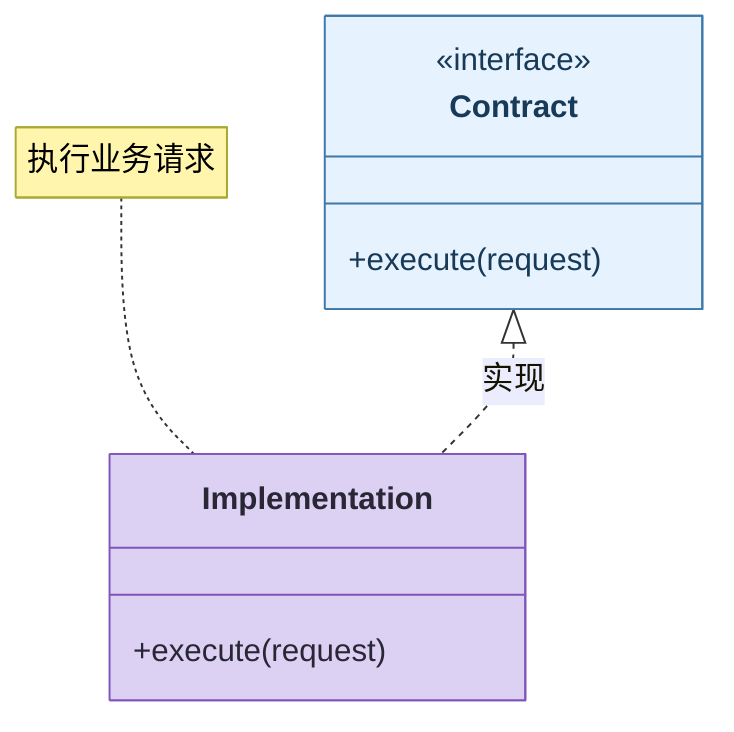

# 类图绘制规范

## 内容与关系真实性

- 每个节点标明实际类型、职责与代表性方法，继承成员注明声明者。正文说明省略的泛型、重载与辅助接口。
- 关系线对应真实声明或使用关系，每条都写标签。间接继承标明「间接」或展开中间类型。用 `note for` 记录职责。

| Mermaid 关系 | 标注 | 含义 |
|---|---|---|
| `Parent <\|-- Child : 继承` | 继承 | 类继承或接口继承，空心三角指向父类型 |
| `Contract <\|.. Implementation : 实现` | 实现 | 类实现接口，虚线空心三角指向接口 |
| `Caller ..> Target : 调用方法` | 具体动作 | 依赖、使用、调用或创建 |
| `Owner --> Target : 委托存取` | 具体动作 | 关联或委托。仅在确有持有关系时称“持有” |
| `Whole o-- Part : 包含结果` | 包含内容 | 聚合/包含，空心菱形在整体一端 |

## 固定视觉样式

背景为白色。默认 `direction TB`。字体沿用 Arial、PingFang SC、Microsoft YaHei 的顺序，Mermaid 基准字号为 16px。保持类名和 `«interface»` / `«abstract»` 标记可见。

| 节点类型 | 底色 | 边线 | 文字 |
|---|---|---|---|
| 接口 | `#E7F2FF` | `#3D78A8` | `#173A58` |
| 具体类 | `#DCD0F3` | `#8055BA` | `#292735` |
| 抽象类 | `#FFF0DD` | `#B67526` | `#694011` |
| 职责注释 | `#FFF5AD` | `#B5A842` | `#333333` |

节点类型颜色写进 Mermaid 原生 `style`，保证 Markdown 和 HTML 的节点配色一致。例如：



关系线用 `#333333`、2px，与图形一起缩放。方法颜色表示用途，字重 600。生成 HTML 后按实际语义补充分组，调整时维护 `methodKinds`。重复生成会恢复模板映射。导出 SVG 保留内联样式。

### 方法颜色

| 用途 | 颜色 | 参考方法 |
|---|---|---|
| 创建 / 构建 | 紫 `#7C1CC4` | `builder`、`mutate`、`prompt` |
| 配置 / 增强 | 琥珀 `#946000` | `user`、`options`、`before`、`after` |
| 执行 / 调用 | 红 `#C21E32` | `call`、`stream`、`executeToolCalls` |
| 读取 / 查询 | 蓝 `#0057D9` | `get*`、`has*`、`find*`、`similaritySearch` |
| 写入 / 清理 | 绿 `#08753B` | `add`、`saveAll`、`delete`、`clear` |

如 Spring AI 的 `content`、`chatResponse`、`entity` 属于执行入口。其他库的同名方法按实际行为判断。

## 布局约束

- 同层类框顶部对齐，箭头尖端贴住目标边。主干优先沿水平和垂直线段，必要拐角用不超过 6px 的小圆角。保留箭头方向、虚实线和关系标签。
- 修改布局器时检查注释和类框重叠、箭头尖端与 marker 锚点、空心箭头和菱形的遮挡。布局器针对内置 Mermaid 12.3.0 的 TB 图，要求层间有间隔、连线首尾段竖直。

## 交互约定

只在改动查看器或布局器时核对受影响项。按需打开 `assets/viewer.html`、`assets/class-diagram-layout.js` 或 `assets/class-diagram-source-links.js`。

- 标签平滑移入可见范围。滚动和拖动浏览标签，点击与键盘切图。减少动态效果时停用额外惯性与平滑定位。切图保持窗口滚动位置。
- 展示模式依次为默认、浏览器全屏、屏幕全屏。全屏保留左上导航与右下控件。缩放支持按钮、适应画布和 Shift + 滚轮（10%–300%）。适应画布按可用宽高缩放。
- 普通视图的两组图例默认收起，展开用浮层，不推挤画布。切换控件保持正确的可达标签。源码链接可键盘操作。成功提示只显示确认打开的符号。
- 用独立技能生成，再迁移 HTML 和模块目录验证离线运行。导出的独立 SVG 应保留配色、标注、形状、对齐及符号元数据。

## 验收清单

1. 逐图确认 `#status` 已隐藏、`#canvas svg` 存在且有尺寸，并核对类型标记、关系标签及预期的 `a.source-link`。可运行浏览器脚本时，按图序等待 `await select(i)`，批量返回失败项。
2. 对复杂、改版或疑似拥挤的图截图，检查方法越界、关系端点、同层对齐和注释重叠。抽查导出的 SVG 可独立打开。
3. 核对 HTML 图源、Markdown 快照及本地资源路径。源码导航分别报告映射覆盖、页面入口和实际打开。

## IDEA 插件源码跳转

映射按 Mermaid 类型 ID 索引。方法键匹配图上展示签名，省略访问符号。参数使用全限定名及擦除后的类型。无参数用 `[]`，数组保留 `[]`。继承方法填写实际声明类，覆写方法指向实际覆写者。重载按调用实参或当前源码核实。

```json
{
  "RequestSpec": {
    "className": "com.example.Client.RequestSpec",
    "methods": {
      "call(request)": {
        "methodName": "call",
        "parameterTypes": ["com.example.Request"]
      }
    }
  }
}
```

- `--require-source-links` 核对已声明的类及类块或行内展示的方法。可用 `scripts/audit_source_map.py` 和同版本 classpath 核对 JVM 声明，参数见 `--help`。
- 用已完成索引的 IDEA 项目和 Diagram Source Navigator 打开本次 HTML，实测类及方法入口。只把最终 `opened` 计为打开成功。依赖缺项与歧义分别记录。完整审计保留逐图入口、去重目标签名和实际打开结果。
- 仅在用户明确要求文件定位时，将目标写成 `{"file":"src/Worker.java","line":8}`。路径相对于映射 JSON，生成器校验行号并复制源码，链接用 `idea://open`。迁移源码前保留相应许可证。独立 SVG 保存符号元数据，IDE 会话导航通过 HTML 使用。
