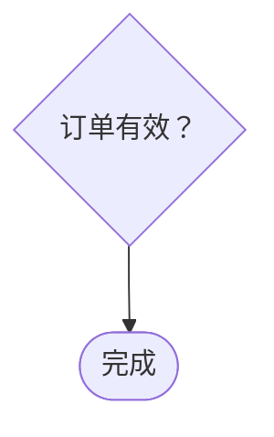

# 流程图规范

## 业务语义

每张图围绕一个入口和目标展开。真实流程根据源码、业务规则或运行证据绘制，概念设计注明假设。每条判断出口写明互斥条件、优先级或兜底；提前返回、异常、拒绝和取消均有明确落点。循环标出继续条件、状态推进和退出；有界重试写明上限或停止条件。汇合表示路径接续；并行处理需要明确的分发、等待和汇聚语义。

## 规划布局

- **直接绘制**适合主链清楚、分支少、自动排版后能一眼看清起止的图。用自动布局起稿，渲染一次后按实际效果微调。
- **先排骨架**适合多级判断、回边、多个异常出口或跨层汇合。先用短标签标出主链中心、同层分支、汇合与终点，并给回线和异常留出侧边车道。确认阅读顺序后再补详细节点和分支标签。已知业务逻辑时，这一步可在工作过程中直接完成。
- **分图**适合主链偏离阅读方向、旁路挤占多个层级或整图缩放后文字太小的场景。用总览交代入口和结果，以预定义子流程节点指向展开图。只有业务本来存在两级分类时，才把分支拆成两级判断。

常用骨架可组合使用：

| 场景 | 排布 |
| --- | --- |
| 纵向调用链 | 主节点共用中心列，异常从侧边引出，同类异常可汇入共同终点 |
| 并列终止结果 | 同层、等尺寸和等距。节点边中点对齐接入直段，两侧分支使用镜像折线 |
| 工具执行或其他循环 | 主链居中，返回下一轮的箭头走外侧。异常通道与回线路径各有清晰落点 |
| 检索命中或提前返回 | 正常处理居中，提前返回放侧边。用紧凑行距控制留白，长异常线对准终点入口 |

## 符号与标签

参考 [ISO 5807](https://www.iso.org/standard/11955.html) 和 [Visio 基础流程图](https://support.microsoft.com/en-us/visio/create-a-basic-flowchart-in-visio) 的常用符号语义。

| 形状 | 含义 | Mermaid | 图例颜色 |
| --- | --- | --- | --- |
| 胶囊形 | 入口、完成或终止结果 | `Start(["开始"])` | 默认浅蓝；明确成功为浅绿，失败或拒绝为浅红 |
| 矩形 | 一个处理动作 | `Process["校验数据"]` | 浅蓝 |
| 菱形 | 决定下一步的条件 | `Check{"数据有效？"}` | 浅黄 |
| 平行四边形 | 跨流程边界的输入或输出 | `Input[/"接收数据"/]` | 浅蓝 |
| 两侧带内竖线的矩形 | 已定义、可另行展开的子流程 | `Sub[["执行子流程"]]` | 浅蓝 |
| 圆柱形 | 数据库或持久化存储 | `Store[("数据存储")]` | 浅蓝 |

查看器按形状给菱形着色。明确成功和失败的结果分别用 `class Done success` 和 `class Reject failure` 标记。跳过、待确认或包含多种结果的通用终点使用默认浅蓝，并在标签里写明状态。只交付 Mermaid 或 Markdown 时，使用[基础模板](../assets/example.md)中的 `classDef` 保留判断与结果颜色。形状、文字和颜色共同表达含义。

使用稳定的英文 ID 和带引号的标签。步骤用动宾短语，判断写成可回答的问题，终点写实际结果。控制流用 `-->`，条件用 `-->|条件|`。标签过长时沿语义边界用 ` ` 换行。使用 `subgraph` 表达业务阶段或责任边界。避免把 `end` 用作节点 ID；以 `o` 或 `x` 开头的节点 ID 前保留空格。

## 对齐、走线与间距

1. **先排节点。** 纵向主链共享中心列，横向主链共享中心行。同层并列节点对齐中心或上沿。同类节点保持相近的宽高与内边距，长标签沿语义换行。判断菱形默认以宽约为高两倍为起点，标签需要空间时适度增高。字号保持一致，文字四周保留边距。形状比例和同类尺寸可参考 [draw.io 基础流程图样例](https://www.drawio.com/docs/reference/diagram-generation/style-reference/#example-1-simple-flowchart)及[尺寸一致性示例](https://www.drawio.com/docs/best-practice/consistent-diagrams/#consistent-shape-sizes)。
2. **再接连线。** 自动布局使用水平和垂直线段，拐弯可用小圆角。直连节点的接点对齐同一行或列。普通节点优先接到边中点，箭头垂直接触该边并和接入线段同向。判断节点从上、下顶点垂直进入。「是」分支默认优先从菱形底部顶点垂直伸出。目标在同一纵列时直接连接下一判断的顶部顶点或矩形上边中点；目标偏移时先从底部伸出，再用正交线绕行。底部无可用通道时改用侧顶点。「否」等旁支从侧顶点水平引出。优先通过横移节点对齐接点；相邻节点挡住落点时，可将目标或同列节点适当上移或下移，以减少拐弯。按阅读顺序继续对齐下一层，保留流程层级、节点间距和分组边界。侧边分支优先一次转弯后垂直接入，纵向主链优先直连。较大的偏移用正交折线连接，优先消除入箭头前的短折返。指向同一节点同一接点的同向、同样式入线可以共用末段和一个箭头。循环回线和顺向出线从不同接点进出。
3. **给文字和箭头留空间。** 主链直连段建议留出约 30 个 SVG 单位，带条件标签时按文字大小加宽或拉开层距。减少整块无用途的留白，同时保持节点、标签与其他连线之间的间隙。
4. **遇到冲突时先保证读图。** 回路或旁路经过空白通道，箭头连到实际目标，标签留在所属连线旁。先调整节点或通道以减少交叉，交叉处用小拱桥跳线，真实汇合保持相接。自动布局在局部空间不足时可能保留 Mermaid 原线，检查结果后调整布局或拆图。

## 手动对齐

先使用 Dagre 自动布局。关键路径仍不对齐或旁路需要独立车道时，可在纵向 Mermaid 图块内加一行 `%% aligned-layout: {...}`。这段注释只由技能查看器解释。手动模式列出图中的全部节点列和边，逐对节点使用单条连接。节点中心对齐后，仍可为回线或旁路指定独立通道。

- `columns` 按节点 ID 指定中心横坐标。`rows` 为 `columns` 内的节点指定可选中心纵坐标。`alignTop` 把形状不同的并列节点对齐到参考节点上沿。
- `decisionHeight` 为菱形指定 0.45 至小于 1 的高度比例，只压缩外形。
- `edges` 每项为 `[起点, 终点, 出口, 入口, 出口偏移, 入口偏移, 车道横坐标]`。端口用 `top`、`bottom`、`left` 或 `right`。普通节点偏移从边中点计算，默认 0。判断节点保持垂直进入。可用 `bottom`、`left` 或 `right` 指定判断节点优先出口。主链直连时可设为 `bottom` 出、`top` 进。需绕行时可给出优先车道横坐标。
- 节点包围盒重叠或间距不足时查看器会回退到自动布局。遮挡、箭头和标签仍须在实际浏览器中检查。

下例保留主链中心列与同层上沿对齐，「是」从底部直下，「否」从左侧引出。

## 源码跳转

交付代码流程 HTML 时，在每个对应的 Mermaid 图块内用一行 `%% source-map: {...}` 按节点 ID 记录源码位置。核对当前工作树或依赖版本中与节点语义直接对应的代码。行号从 1 开始，按整个 Java 源文件计数。嵌套类可用点号或 `$`。汇合点、概念节点和无法核实的外部步骤可省略映射。在正文说明重要缺项。更新流程时重核节点 ID 和源码位置。

1. **映射覆盖。** 核对 Markdown 的节点 ID、类名、行号和生成 HTML 中的 `script#source-map`。代码流程图的空映射要补齐后再交付。
2. **页面入口。** 在已完成项目同步和索引的 IDEA 中，通过 Diagram Source Navigator 的 **Open HTML Diagrams…** 打开本次生成的 HTML，逐图核对映射节点可点击或可聚焦。旧预览可能继续提供上一版 HTML，生成后通过插件重新打开文件。
3. **实际跳转。** 点击节点或用 Tab 和 Enter 打开源码，核对 IDEA 中的文件和光标行。切图后复查重复的节点 ID 是否指向各自的位置。依赖类须关联同版源码。同名类候选按模块或依赖路径确认。分别报告映射、入口和打开结果，缺少 IDEA 或插件时把打开结果标为未验证。

## 查看器与交付

- 查看器沿用类图、时序图的紧凑页头、紫色选中标签和白色滚动画布。右上角折叠图例解释符号。核对画布和导出 SVG 的符号与颜色是否和图例一致。
- `适应画布` 按宽高缩放，切图保留缩放方式。手动缩放支持按钮与 Shift + 滚轮，溢出时支持普通滚轮、触控和鼠标拖动。全屏保留切图和缩放，Esc 返回。导航标签用原生横向滚动与鼠标惯性拖动，点击标签选择场景；启用减少动态效果时停用额外惯性与平滑定位。
- HTML 入口位于交付目录顶层，Markdown 和资源归入 `flowcharts/` 模块。迁移时按相对路径与模块目录一起搬移。Markdown 只需源码、依据和说明时，按请求交付即可。

## 验收清单

- **流程走读**：从入口沿每个出口和回边走到目标。确认条件完整，跨图子流程有衔接点，箭头的视觉入口与 Mermaid 业务关系一致。
- **画布**：逐图查看适应画布与实际大小。检查混排的节点尺寸和文字留白，再核对节点和直线段对齐，普通箭头落在边中点且和线段同向，判断节点垂直进入，核对「是」分支是否优先从底部顶点伸出、旁支是否从侧顶点伸出。检查分支落线对齐、末端短折返、空白通道、标签间距，以及合流和跳线是否清楚。发现问题时调整源 Markdown 再生成。
- **源码跳转**：按上面的[源码跳转](#源码跳转)完成三项核对。
- **离线交付**：核对 HTML 图源、Markdown 快照和相对资源路径。检查导出 SVG 可独立打开并保留文字、箭头、跳线与样式。若改了查看器或资源，独立复制技能后生成，再单独迁移产物验证切图、图例、缩放、拖动和全屏等受影响功能。

语法参考 [Mermaid 官方流程图文档](https://mermaid.js.org/syntax/flowchart.html)。以技能自带运行库的实测效果为准。
