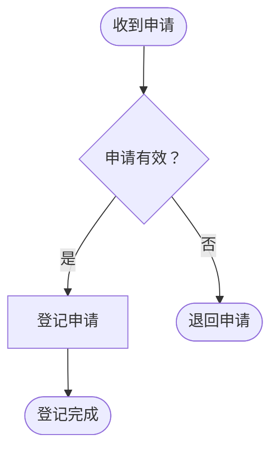

# 流程图规范

## 业务语义

每张图围绕一个入口和目标展开。真实流程根据源码、业务规则或运行证据绘制，概念设计注明假设。每条判断出口写明互斥条件、优先级或兜底。提前返回、异常、拒绝和取消均有明确落点。循环标出继续条件、状态推进和退出。有界重试写明上限或停止条件。汇合表示路径接续。并行处理需要明确的分发、等待和汇聚语义。

## 规划布局

按技能入口先确定分图。总览用预定义子流程节点标明对应的展开图，子图注明入口、出口与总览的衔接点。分支层次以实际规则为依据。先给每张图安排主链、同层分支、汇合和结果，再补细节。

| 场景 | 排布 |
| --- | --- |
| 纵向调用链 | 主节点共用中心列，异常从侧边引出，同类异常可汇入共同终点 |
| 并列终止结果 | 同层、等尺寸和等距。节点边中点对齐接入直段，两侧分支使用镜像折线 |
| 工具执行或其他循环 | 主链居中，返回下一轮的箭头走外侧。异常通道与回线路径各有清晰落点 |
| 检索命中或提前返回 | 正常处理居中，提前返回放侧边。用紧凑行距控制留白，长异常线对准终点入口 |

首张渲染时核对 `viewBox`、画布与适应比例。若读清主链需要连续滚动多屏，或适应后标签太小，优先按业务阶段或独立分支拆分，随后才微调节点间距或走线。

## 符号与标签

| 形状 | 含义 | Mermaid | 图例颜色 |
| --- | --- | --- | --- |
| 胶囊形 | 入口、完成或终止结果 | `Start(["开始"])` | 默认浅蓝。明确成功为浅绿，失败或拒绝为浅红 |
| 矩形 | 一个处理动作 | `Process["校验数据"]` | 浅蓝 |
| 菱形 | 决定下一步的条件 | `Check{"数据有效？"}` | 浅黄 |
| 平行四边形 | 跨流程边界的输入或输出 | `Input[/"接收数据"/]` | 浅蓝 |
| 两侧带内竖线的矩形 | 已定义、可另行展开的子流程 | `Sub[["执行子流程"]]` | 浅蓝 |
| 圆柱形 | 数据库或持久化存储 | `Store[("数据存储")]` | 浅蓝 |

查看器按形状给菱形着色。明确成功和失败的结果分别用 `class Done success` 和 `class Reject failure` 标记。跳过、待确认或包含多种结果的通用终点使用默认浅蓝，并在标签里写明状态。只交付 Mermaid 或 Markdown 时，使用[基础模板](../assets/example.md)中的 `classDef` 保留判断与结果颜色。形状、文字和颜色共同表达含义。

使用稳定的英文 ID 和带引号的标签。步骤用动宾短语，判断写成可回答的问题，终点写实际结果。控制流用 `-->`，条件用 `-->|条件|`。标签过长时沿语义边界用 ` ` 换行。使用 `subgraph` 表达业务阶段或责任边界。避免把 `end` 用作节点 ID。以 `o` 或 `x` 开头的节点 ID 前保留空格。

## 对齐、走线与间距

1. 主链共享中心行或列，同层并列节点对齐中心或上沿。同类节点用相近尺寸和内边距，长标签按语义换行。
2. 直连优先，绕行用正交线与小圆角。普通箭头垂直接入边中点。纵向主链优先从判断菱形顶点进入，底部接「是」分支，侧边接旁支。通道不足时换可用接点，避免短折返。回边与顺向线用不同接点。
3. 回线和旁路走空白通道，标签靠近所属的线。交叉用跳线，汇合须相接。主链直连建议留约 30 个 SVG 单位，遇标签先留空间再调整布局或拆图。

## 手动对齐

先使用 Dagre 自动布局。关键路径仍不对齐或旁路需要独立车道时，可在纵向 Mermaid 图块内加一行 `%% aligned-layout: {...}`。这段注释只由技能查看器解释。手动模式列出图中的全部节点列和边，逐对节点使用单条连接。节点中心对齐后，仍可为回线或旁路指定独立通道。

- `columns` 按节点 ID 指定中心横坐标。`rows` 为 `columns` 内的节点指定可选中心纵坐标。`alignTop` 把形状不同的并列节点对齐到参考节点上沿。
- `decisionHeight` 为菱形指定 0.45 至小于 1 的高度比例，只压缩外形。
- `edges` 每项为 `[起点, 终点, 出口, 入口, 出口偏移, 入口偏移, 车道横坐标]`。端口用 `top`、`bottom`、`left` 或 `right`。普通节点偏移从边中点计算，默认 0。判断节点保持垂直进入。可用 `bottom`、`left` 或 `right` 指定判断节点优先出口。主链直连时可设为 `bottom` 出、`top` 进。需绕行时可给出优先车道横坐标。
- 节点包围盒重叠或间距不足时查看器会回退到自动布局。遮挡、箭头和标签仍须在实际浏览器中检查。

下例保留主链中心列与同层上沿对齐，「是」从底部直下，「否」从左侧引出。

## 源码跳转

交付代码流程 HTML 时，在每个对应的 Mermaid 图块内用一行 `%% source-map: {...}` 按节点 ID 记录源码位置。核对当前工作树或依赖版本中与节点语义直接对应的代码。行号从 1 开始，按整个 Java 源文件计数。嵌套类可用点号或 `$`。汇合点、概念节点和无法核实的外部步骤可省略映射。在正文说明重要缺项。更新流程时重核节点 ID 和源码位置。

按源码中实际分支、写入或声明的位置填写行号。图示涉及依赖时核对同版本源码。验证 IDEA 时用 Diagram Source Navigator 重新打开本次 HTML，点击节点或按 Tab 和 Enter，核对文件与光标行。重复节点 ID 按图号区分，同名类按模块确认。分别记录 DOM 入口和实际打开结果。

## 查看器维护

改查看器时按影响范围核对切图、滚动与拖动、缩放、全屏和图例。切图保留缩放方式。滑动浏览标签，点击切图。减少动态效果时停用额外惯性。独立复制技能生成后，迁移产物验证离线查看与导出。

## 验收清单

1. 逐图确认 `#status` 已隐藏、`#canvas svg` 存在且有尺寸，并用 `[data-source-symbol]` 核对预期节点。可运行浏览器脚本时，按图序等待 `await select(i)`，批量返回失败项。
2. 从入口走读各出口和回边。只对复杂、改版或疑似拥挤的图截图核对端点、回线、标签和分支对齐。需要改图时修改 Markdown 后重生成。
3. 核对图源、资源相对路径和独立 SVG。导出抽查文字、箭头、跳线和样式。实际跳转按[源码跳转](#源码跳转)核对。

语法参考 [Mermaid 官方流程图文档](https://mermaid.js.org/syntax/flowchart.html)。以技能自带运行库的实测效果为准。
